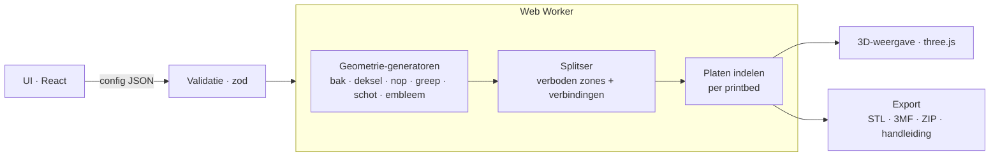

# BrikBox — modulair, afsluitbaar en stapelbaar opbergsysteem voor brikken

> **Naam:** BrikBox · **Status:** concept v0.4 · **Datum:** 27-10-2026
>
> Dit document beschrijft het systeem (de fysieke dozen) én de webapp die de printbestanden genereert. Het is de basis voor de latere Git-repository.

---

## 1. Aanleiding

De bekende opbergdozen in de vorm van een grote brik (geel/rood, deksel met 8 noppen, handgrepen aan de korte kanten) zijn mooi en stapelbaar, maar:

- **Het deksel ligt los.** Optillen aan de handgreep = deksel blijft liggen of valt eraf. Niet geschikt voor transport.
- **De indeling is vast.** Via MakerWorld bestaat een inzet met 8 vakken; een versie met 4 vakken is zelf gemaakt. Wens: ook 2 vakken, en vrij combineren ("1 groot + 4 klein", zoals in de gele doos).
- **Eén maat.** Je kunt de afmetingen niet aanpassen aan je verzameling of je kast.

De bestaande dozen zijn **alleen inspiratie**: het nieuwe systeem hoeft er niet mee compatibel te zijn en heeft zijn eigen maten.

**Doel:** een eigen, 3D-printbaar systeem dat de look van een brik houdt, maar afsluitbaar, modulair en volledig aanpasbaar is — met een webapp die de STL/3MF-bestanden maakt, ook als de doos groter is dan je printbed.

## 2. Doelen en niet-doelen

**Doelen**

1. Doos + deksel die **vast dichtgaan** voor transport (klap-/klikgrendel, optioneel draaigrendel).
2. **Stapelbaar** via noppen op het deksel, ook *in verband* (zoals echte steentjes: een grote doos op twee kleine).
3. **Vrij te kiezen afmetingen** (breedte, diepte, hoogte) op een vast **raster**, zodat alles op elkaar past.
4. **Indeling naar keuze:** 1, 2, 4, 8 vakken of zelf tekenen; losse schotten, inzetbak of bakjes.
5. **Thema's** in de handgrepen (wisselbaar embleem: Mario, Star Wars, kasteel, eigen ontwerp).
6. **Automatisch splitsen** van te grote onderdelen in printbare stukken die in elkaar klikken.
7. Alles **zonder support** printbaar.
8. Een **webapp** die volledig in de browser draait (geen server, gratis te hosten via GitHub Pages).

**Niet-doelen (voorlopig)**

- Geen spuitgieten of massaproductie.
- Geen officieel product van een speelgoedmerk; merknamen en logo's worden niet in het project gebruikt of meegeleverd (zie §7.4).
- Geen accounts/database; configuraties worden gedeeld via een link of JSON-bestand.

## 3. Onderdelen in één oogopslag

| Onderdeel | Functie | Printen |
|---|---|---|
| **Bak** | De doos zelf, met gleuven voor schotten en groeven in de bodem voor stapelen | Rechtop, opening boven |
| **Deksel** | Sluit de bak, draagt de noppen, ribben aan de onderkant sluiten de vakken af | Ondersteboven (bovenkant op het bed → mooie gladde/getextureerde bovenkant) |
| **Noppen** | Stapelen + uiterlijk; los geprint en met een kwartslag (bajonet) op het deksel gedraaid | Rechtop, klein, in elke kleur |
| **Klapgrepen** | Handgreep + grendel in één: klapt over de dekselrand en klikt vast | Plat |
| **Emblemen** | Themaplaatje dat in de klapgreep schuift | Plat, evt. meerkleurig (AMS) |
| **Schotten** | Vakverdeling, kruisend (eierdoos-principe) | Plat |
| **Inzetbak** *(alternatief)* | Complete indeling in één stuk, zoals de MakerWorld-divider | Rechtop |
| **Bakjes / toptray** | Kleine uitneembare bakjes voor minifig-onderdelen e.d. | Rechtop |
| **Verbindingsstukken** | Alleen bij gesplitste prints (sleutels, klemmen) | Plat |

## 4. Het raster — de basis van alles

Alles in het systeem is opgebouwd uit **rastercellen**. Zo passen dozen van verschillende maten op elkaar, vallen schotten altijd in een gleuf en weet de splitser waar hij mag knippen.

| Grootheid | Waarde (standaard) | Toelichting |
|---|---|---|
| Rastermaat **R** | 42 mm | Gelijk aan Gridfinity → bestaande Gridfinity-bakjes passen in het ecosysteem |
| Breedte / diepte | `n × R − 0,5 mm` | Buitenmaat; 0,5 mm speling zodat dozen naast elkaar passen |
| Hoogte-eenheid | 7 mm | Hoogte van de bak in stappen van 7 mm (ook Gridfinity) |
| Noppenraster | 2 R = 84 mm | 1 nop per 2×2 cellen → een 8×4-doos krijgt 4×2 = 8 noppen, net als het origineel |
| Nopdiameter | 0,6 × 84 ≈ 50 mm | Zelfde verhouding als de nop van een gewone brik (4,8 / 8,0) |

**Voorbeeldmaten**

| Cellen (B×D) | Buitenmaat | Noppen | Lijkt op |
|---|---|---|---|
| 4×2 | 167,5 × 83,5 mm | 2×1 | Klein bakje |
| 4×4 | 167,5 × 167,5 mm | 2×2 | "Steen 4" |
| 8×4 | 335,5 × 167,5 mm | 4×2 | Het originele 8-noppen-model |
| 8×8 | 335,5 × 335,5 mm | 4×4 | Grote speelgoedkist |

Even aantallen cellen worden aangeraden (anders valt er een halve nop weg). De app staat oneven maten toe maar waarschuwt dan.

### Ontwerpbeslissing: raster op buitenmaat of binnenmaat?

| | Raster op **buitenmaat** (aanbevolen) | Raster op **binnenmaat** |
|---|---|---|
| Stapelen in verband | ✅ Ja, dozen tegen elkaar = exact op raster | ❌ Wanddikte verstoort het raster |
| Gridfinity-bakjes erin | ⚠️ Net niet (binnen ≈ n·42 − 5 mm) | ✅ Exact n×n bakjes |
| Brik-gevoel | ✅ | — |

**Besloten (B6): raster op buitenmaat.** Een schakelaar "Gridfinity-binnenmaat" kan later als optie in de app komen.

## 5. Stapelen

- **Noppen op het deksel** steken in **ringvormige groeven in de bodem** van de doos erboven. Een ringgroef (ca. 4 mm breed) is zonder support te printen, een volledig gat van 50 mm niet netjes.
- Omdat het noppenraster overal hetzelfde is, kun je **in verband stapelen**: een 8×4-doos op twee 4×4-dozen, of verschoven met een halve doos.
- **Nophoogte** is instelbaar: ca. 5 mm grijpt in de groef, de rest is zichtbaar (standaard 10 mm zichtbaar, zoals op de foto).
- **Draagvermogen:** een volle doos brikken weegt al snel 3–4 kg. Het gewicht gaat via de noppen naar het deksel; de **ribben onder het deksel** liggen precies onder de noppen en verdelen de last naar de wanden.
- **Waarom losse noppen?** Het deksel wordt ondersteboven geprint (gladde bovenkant, lip en ribben naar boven). Noppen eraan vast zouden dan in de lucht hangen. Losse noppen lossen dat op én geven extra mogelijkheden: wisselbare kleuren (kleurcodering per inhoud!), thema-noppen, kapotte nop = alleen nop herprinten.

## 6. Deksel en sluiting

### 6.1 Het deksel

- Vlakke plaat (±3 mm) met een **binnenlip** (±4 mm) die in de bak valt → stofdicht en zelfcentrerend.
- **Ribbenraster** aan de onderkant op elke rasterlijn (elke 42 mm). Schotten staan óók op rasterlijnen en lopen door tot net onder de ribben (0,4 mm). Resultaat: **elk vak is afgesloten als het deksel dicht is** — kleine onderdelen schuiven tijdens transport niet naar een ander vak.

### 6.2 Sluitopties

| Optie | Hoe | Plus | Min |
|---|---|---|---|
| **A. Klapgreep** *(gekozen, B7)* | Greep scharniert aan de korte zijwand, klapt omhoog over de dekselrand en klikt vast | Greep + slot + themadrager in één; robuust; vertrouwd (zoals een Really Useful Box) | Scharnier nodig (filament-pen) |
| **B. Draaigrendel** | Een nop-vormige knop op het deksel; een kwartslag draait een nok onder een richel in de bak | Ziet eruit als een nop; erg "brik" | Lastiger te printen, minder kracht |
| **C. Schuifdeksel** | Deksel schuift via zwaluwstaartrails in de bak, klikt aan het eind vast | Zeer stevig, geen losse delen | Bij stapelen moet je de doos eruit halen om te openen |
| **D. Los** | Zoals het origineel | Simpel | Niet voor transport |

**Besloten (B7): klapgreep (optie A) is de standaardsluiting.** De draaigrendel kan later als extra optie in de app komen.

### 6.3 Klapgreep in detail (optie A)

```
   zijaanzicht korte kant (dicht)          (open)

        ┌─nop─┐                               ┌─nop─┐
   ═════╧═════╧══╗  ← dekselrand         ═════╧═════╧═══
                 ║◄ haak klikt               │
   ┌─────────────╢   over de rand            │   ╱ greep klapt
   │   BAK       ║◄ embleem                  │  ╱  naar beneden
   │             ║                           │ ╱
   │             ●  ← scharnier (pen)        │●
```

- **Scharnier:** knokkels aan de bakwand, pen = stukje **1,75 mm filament** (gratis, altijd voorradig). Gaten in druppelvorm zodat ze zonder support printen.
- **Klik:** een klein nokje op de haak klikt over een richeltje op de dekselrand. Greep in **PETG** (veert, breekt niet), bak/deksel in PLA mag.
- **Greep steekt niet boven het deksel uit** → stapelen blijft mogelijk.
- **Aantal:** 2 (korte kanten); bij dozen langer dan ±6 cellen optioneel ook aan de lange kant.
- **Embleemvak:** de buitenkant van de greep heeft een zwaluwstaartsleuf waar het themaplaatje in schuift.

## 7. Thema's

### 7.1 Embleem in de greep

Het embleem is een los plaatje (standaard ca. 50 × 30 mm, schaalt mee met de greep) dat in de klapgreep schuift. Wisselen van thema = alleen een nieuw plaatje printen.

### 7.2 Bronnen voor een thema

1. **Ingebouwde, zelfgemaakte thema-iconen** (ruimte, kasteel, piraten, stad, techniek, trein, …).
2. **Eigen SVG uploaden** — bijvoorbeeld een Mario-paddenstoel of een Star Wars-logo voor eigen gebruik.
3. **Tekst** ("Technic", "Minifigs", naam van een kind) in verschillende lettertypes.
4. *(Later)* Afbeelding → reliëf/hoogtekaart.

### 7.3 Meerkleurig printen

- Elke kleur in de SVG wordt een apart lichaam → export als **3MF met kleur per onderdeel**, zodat je in Bambu Studio / PrusaSlicer direct filamenten (AMS) toewijst.
- Alternatief zonder AMS: kleuren op verschillende **hoogtes** → handmatige kleurwissel per laag.
- Thema doortrekken: **noppen** en **grepen** in de themakleur (Mario: rood/geel; Star Wars: grijs/zwart).

### 7.4 Merken en rechten — belangrijk voor de Git-repo

- Namen en logo's van speelgoed-, game- en filmmerken (zoals "Mario" en "Star Wars") zijn merken/auteursrechtelijk beschermd. **Voor eigen gebruik prima**, maar:
  - Lever die logo's **niet** mee in de repository of in een openbare themagalerij.
  - Gebruik geen merknamen in de projectnaam, de app of de README. Daarom heet het systeem BrikBox en spreken we overal van "brikken".
  - Bij publicatie op MakerWorld/Printables: zonder beschermde logo's.
- Daarom het SVG-upload-principe: de gebruiker brengt zijn eigen thema mee.

## 8. Indeling: schotten, mix & match

### 8.1 Losse schotten (standaard)

- De binnenwanden hebben **verticale gleuven op elke rasterlijn**.
- Schotten zijn platte stroken (plat printen = snel en sterk) die in de gleuven schuiven.
- **Kruisende schotten** met halve inkepingen (eierdoos-principe): lengteschotten ingekeept van boven, dwarsschotten van onder.
- **T-verbindingen** (een schot dat halverwege tegen een ander schot eindigt) met een klein T-klemmetje.
- Bovenkant met **vingeruitsparing** zodat je ze er makkelijk uittrekt.
- Schothoogte: *vol* (tot de ribben → lekdicht) of *half* (makkelijker grabbelen).

### 8.2 Presets

1 vak · 2 vakken · 3 · 4 · 6 · 8 · "1 groot + 4 klein" · "1 groot + 2 klein" · leeg (alleen gleuven)

### 8.3 Zelf tekenen

In de app zie je het raster van bovenaf; je **voegt cellen samen** tot vakken door te slepen. De app berekent welke schotten (en klemmetjes) nodig zijn.

### 8.4 Alternatieven en aanvullingen

- **Inzetbak in één stuk** (zoals de MakerWorld-divider): dezelfde getekende indeling, maar als één printbaar geheel. Minder losse delen, meer filament.
- **Bakjes** (1×1, 1×2, 2×2 cellen) met een **schepvormige bodem** — kleine onderdeeltjes schep je er met één vinger uit.
- **Toptray:** een ondiep uitneembaar bakje dat bovenin op een richel hangt (zoals bij een gereedschapskist) — ideaal voor minifig-hoofden, wapens, 1×1-plaatjes.

## 9. Groter dan je printer: automatisch splitsen

### 9.1 Printerprofielen

**Referentieprinter voor ontwikkeling en testprints: Bambu Lab X1-Carbon met AMS.** De app is echter printer-onafhankelijk: het bouwvolume is gewoon een instelling, dus kleine én grote printers werken.

| Klasse | Voorbeelden | Bouwvolume (ca.) |
|---|---|---|
| Klein | Bambu Lab A1 mini | 180 × 180 × 180 mm |
| Standaard | **Bambu Lab X1C** / P1S / A1, Prusa Core One, Creality Ender-3 V3 | 220–256 mm |
| Groot | Bambu Lab H2D, Creality K2 Plus, Prusa XL, Voron 2.4 (350) | ±320–360 mm |
| Zeer groot | Elegoo OrangeStorm Giga e.d. | 800 mm en meer |
| Eigen | vrij in te vullen (B × D × H) | — |

- Profielen staan in één databestand (`src/config/printers.json`): een printer toevoegen = één regel, ook via een pull request van anderen.
- Per profiel: bouwvolume, veiligheidsmarge (standaard 5 mm) en of er **meerkleurig** geprint kan worden (AMS/MMU/toolchanger). Zonder meerkleurig krijg je emblemen met kleurwissel-per-laag of in één kleur.
- Maten van de profielen bij het bouwen van de app nog verifiëren bij de fabrikant.

**Wat de printer bepaalt**

| Doos 8×4 (335,5 mm) | Resultaat |
|---|---|
| A1 mini (180) | Bak en deksel elk in 2 stukken (eventueel 3) |
| X1C (256) | Bak en deksel elk in 2 stukken |
| Prusa XL / K2 Plus (±350) | In één keer, geen naden |

**Toch splitsen terwijl het past?** Instelling *maximale stukgrootte*: ook op een grote printer kun je kiezen voor kleinere stukken, bijvoorbeeld om de printtijd per plaat te beperken, het risico van een mislukte 20-uursprint te verkleinen of meerdere printers tegelijk te laten werken.

### 9.2 Waar mag geknipt worden? ("verboden zones")

De splitser kent per onderdeel de zones waar **niet** geknipt mag worden: schotgleuven, noppen en hun groeven, scharnieren, grepen, labelvakken. Daarna kiest hij het **kleinste aantal stukken** dat op het bed past, met naden in toegestane zones en zo gelijk mogelijke stukken.

- **Bak:** naden halverwege een cel (niet op een gleuf).
- **Deksel:** naden langs een rib (de rib wordt dan de verbinding → extra stevig).
- Zo liggen de naden van bak en deksel automatisch **verspringend** → de dichte doos is stijver dan de losse helften.

### 9.3 Verbindingen

| Plek | Verbinding | Toelichting |
|---|---|---|
| Bodem | **Puzzel-zwaluwstaarten** | Met de hand in elkaar drukken; schuift niet uit elkaar |
| Wanden | **Schuif-zwaluwstaart** (verticaal) | Van boven in elkaar schuiven, sluit de naad af |
| Deksel | Zwaluwstaart in de rib | Onzichtbaar vanaf de bovenkant |
| Extra (optioneel) | Vlinder-sleutels, lijm (CA/2K) of M3-bout + inzetmoer | Voor wie het muurvast wil |

- Elk stuk krijgt een **ingeprint ID** op een onzichtbare plek (bijv. `B-1/2`, `D-2/2`).
- De app levert een **montagehandleiding** (welk stuk waar, in welke volgorde).
- **Schotten** die te lang zijn worden op een kruispunt gesplitst: het kruisende schot houdt beide helften op hun plek.
- **Hoogte** te groot? Optioneel **verhoogringen**: bak + ring(en) + deksel. (Bij 256 mm bouwhoogte zelden nodig.)

### 9.4 Splitsalgoritme (schets)

```text
voor elk onderdeel:
  bed = min(printerbed, maxStukgrootte) − marge − ruimte voor verbindingen
  als onderdeel past (ook 90° gedraaid): klaar
  verboden = zones(onderdeel)            # gleuven, noppen, scharnieren, …
  voor nx = 1.., ny = 1.. (oplopend aantal stukken):
    zoek naadposities buiten 'verboden' waarbij elk stuk ≤ bed
    kies de oplossing met de meest gelijke stukken
  voeg verbindingen toe op elke naad, nummer de stukken
  controleer: elk stuk is een geldig (manifold) lichaam en past op het bed
```

## 10. Printregels

| Onderdeel | Oriëntatie | Materiaal (advies) |
|---|---|---|
| Bak | Rechtop | PLA of PETG |
| Deksel | Bovenkant op het bed | PLA of PETG |
| Noppen | Rechtop | PLA (elke kleur) |
| Klapgrepen | Plat | **PETG** (moet veren) |
| Emblemen | Plat | PLA, meerkleurig |
| Schotten | Plat | PLA |

- **Geen support**: overhangen ≤ 45°, horizontale gaten in druppelvorm, groeven smal genoeg om te overbruggen.
- **Olifantspoot-afschuining** (0,4 mm) aan de onderrand van elk onderdeel.
- **Toleranties** instelbaar, standaard 0,2 mm voor schuivende delen en 0,15 mm voor klemmende delen — eerst kalibreren met de testprint (§13).
- **Wanddikte** standaard 2,4 mm (≈ 6 lijnen bij 0,4 mm nozzle), bodem ≈ 7 mm i.v.m. de noppengroeven.
- De app geeft per onderdeel een **schatting van gewicht, filament en kosten**.

## 11. De webapp

### 11.1 Gebruikersflow

1. **Printer** kiezen (of eigen bedmaat).
2. **Afmetingen**: cellen breed × diep, hoogte in stappen van 7 mm. Live 3D-weergave + buitenmaat in mm.
3. **Deksel & sluiting**: type sluiting, nophoogte, nopkleur.
4. **Indeling**: preset of zelf tekenen; schotten, inzetbak of bakjes.
5. **Thema**: embleem (icoon / SVG / tekst), kleuren.
6. **Extra's**: toptray, labelvak, instructieboekjesvak, …
7. **Exporteren**: splitsvoorbeeld (exploded view, elk printbed een kleur), filamentschatting, download als ZIP.

### 11.2 Architectuur



### 11.3 Techniekkeuze

| Onderdeel | Keuze | Waarom |
|---|---|---|
| Framework | **Vite + React + TypeScript** | Snel, bekend, statisch te hosten |
| Geometrie | **manifold-3d** (WebAssembly) | Zeer snelle, robuuste booleaanse bewerkingen; levert altijd printbare (manifold) modellen; 2D-profielen met afronding via `CrossSection` |
| 3D-weergave | **three.js** (+ react-three-fiber) | Standaard; SVGLoader voor emblemen |
| Rekenwerk | **Web Worker** | UI blijft vloeiend tijdens genereren |
| Config | **zod**-schema | Eén bron van waarheid voor UI, validatie en opslaan |
| Export | Eigen STL/3MF-writer + **fflate** (ZIP) | Klein, geen server nodig |
| Hosting | **GitHub Pages** via GitHub Actions | Gratis, automatisch bij elke push |

**Overwogen alternatieven**

- *OpenSCAD (WASM):* bekend bij makers en bruikbaar in MakerWorld's Parametric Model Maker, maar trager en lastiger te koppelen aan een interactieve UI. → Mogelijk later een "export naar OpenSCAD"-variant voor MakerWorld.
- *replicad / OpenCascade:* echte afrondingen en STEP-export, maar ±10 MB WASM en trager. → Alleen als STEP-export gewenst wordt.

### 11.4 Configuratie (voorbeeld)

```json
{
  "versie": 1,
  "printer": { "profiel": "bambu-x1c", "marge": 5, "maxStukgrootte": null },
  "raster": { "R": 42, "modus": "buitenmaat" },
  "bak": { "cellenB": 8, "cellenD": 4, "hoogteEenheden": 20, "wand": 2.4 },
  "deksel": { "sluiting": "klapgreep", "nopHoogteZichtbaar": 10, "nopKleur": "#d01012" },
  "indeling": { "type": "schotten", "preset": "1groot+4klein", "schotHoogte": "vol" },
  "thema": { "embleem": { "bron": "svg", "bestand": "mario.svg" }, "greepKleur": "#f5cd2f" },
  "extras": { "toptray": true, "labelvak": true },
  "tolerantie": { "schuif": 0.2, "klem": 0.15 }
}
```

- Configuratie wordt opgeslagen in de **URL** (delen = link kopiëren) en is te downloaden als JSON.
- Elke ZIP bevat ook `config.json`, zodat je later exact hetzelfde kunt hergenereren.

### 11.5 Inhoud van de download

```
brikbox-8x4x20/
├── platen/                 # één 3MF per printbed, onderdelen al ingedeeld
├── onderdelen/             # elk onderdeel apart als STL
├── handleiding.html        # montagevolgorde, onderdeel-ID's, benodigdheden
├── stuklijst.txt           # incl. niet-geprinte delen: filament-pennen, evt. magneten/bouten
└── config.json
```

## 12. Git-repository

### 12.1 Voorgestelde structuur

```
brikbox/
├── src/
│   ├── config/        # zod-schema, presets, printers.json
│   ├── geometry/      # generatoren: box, lid, stud, latch, divider, badge, joints
│   ├── split/         # verboden zones, naadkeuze, verbindingen
│   ├── export/        # stl, 3mf, zip, handleiding
│   ├── worker/        # web worker-entry
│   └── ui/            # React-componenten
├── themes/            # alleen eigen/vrije iconen (SVG)
├── test-prints/       # tolerantie-testprint
├── docs/              # dit document, montage, kalibratie
├── tests/             # vitest
└── .github/workflows/ # build + deploy naar GitHub Pages
```

Begin als één Vite-app; opsplitsen in packages kan later als dat nodig blijkt.

### 12.2 Tests

Geometrie is goed automatisch te testen (vitest):

- Elk gegenereerd onderdeel is **manifold** (waterdicht) en heeft een volume > 0.
- Na het splitsen **past elk stuk op het bed** van elk printerprofiel.
- Noppen passen in groeven, schotten in gleuven (maatcontrole met toleranties).
- Geen naad in een verboden zone.
- Presets genereren zonder fouten (snapshot van afmetingen/volume).

### 12.3 Licentie

- Code: **MIT** ([LICENSE](../LICENSE)).
- Ontwerpen en documentatie (`docs/`, `themes/`, `test-prints/`): **CC BY 4.0** ([LICENSE-DESIGNS.md](../LICENSE-DESIGNS.md)).
- Bestanden die gebruikers met de app genereren zijn van henzelf: printen, delen en verkopen mag zonder beperkingen.
- Geen merknamen in README of app, dus ook geen handelsmerk-disclaimer nodig.

## 13. Wat ook nog handig kan zijn

- **Tolerantie-testprint** *(heel belangrijk, eerst doen)*: klein proefstuk met nop + groef, schuifgleuf, scharnier, klik en zwaluwstaart in verschillende toleranties. Eerst afstellen, dan pas de grote doos van 10 uur printen.
- **Instructieboekjesvak** onder het deksel: bouwinstructies gaan mee met de set.
- **Bouwplaat-deksel**: een deksel met noppen op het gewone brik-formaat (8 mm raster), zodat je er brikken op kunt bouwen. Lastig te printen (precisie); als optie met eigen tolerantie-instelling.
- **Labels**: een inschuifvak aan de lange kant voor een geprint labelplaatje of papiertje; optioneel een **QR-code** in reliëf die naar een lijst met inhoud linkt (bijv. een Rebrickable-set of eigen lijst).
- **Kleurcodering met noppen**: rode noppen = Technic, gele = City, … — zie je meteen in de kast.
- **Koppelclips** om dozen naast elkaar aan elkaar te klikken.
- **Stapelklem / draagband-sleuven**: een hele toren in één keer verplaatsen.
- **Rolplateau** met wieltjes en noppen bovenop: een stapel wordt een verrijdbare kist.
- **Stapelplanner** in de app: plan je hele kast of kastvak en zie welke dozen je nodig hebt.
- **Sorteeradvies**: presets per soort verzameling (op kleur, op type onderdeel, per set).
- **Publiceren op MakerWorld/Printables** met een link naar de webapp.

## 14. Roadmap

| Fase | Inhoud | Klaar als… |
|---|---|---|
| **0. Prototype** | Tolerantie-testprint; handmatig 4×2-doosje met deksel, nop en klapgreep | Testprint werkt op de X1C; klik en nop voelen goed |
| **1. MVP-app** | Bak + deksel + noppen, maatkeuze, presets schotten, STL-export, waarschuwing als iets niet past | Je kunt een 4×4-doos in de app maken en printen |
| **2. Sluiting & thema** | Klapgreep + emblemen (iconen, tekst, SVG), 3MF met kleuren | Mario-doos met gesloten deksel uit de app |
| **3. Splitsen** | Verboden zones, verbindingen, plateindeling, montagehandleiding, maximale stukgrootte | 8×4-doos in 2 delen geprint op de X1C en gemonteerd; tests bewijzen dat elk stuk op elk profiel past |
| **4. Indeling+** | Vakken tekenen, inzetbak, bakjes, toptray, Gridfinity-modus | Eigen indeling getekend en geprint |
| **5. Extra's** | Labels/QR, koppelclips, rolplateau, stapelplanner, delen via link | — |

## 15. Beslissingen en open vragen

**Besloten**

| # | Vraag | Besluit |
|---|---|---|
| B1 | Referentieprinter | Bambu Lab X1-Carbon met AMS; app ondersteunt alle printers, klein t/m zeer groot (§9.1) |
| B2 | Compatibel met de bestaande opbergdozen? | Nee, die zijn alleen inspiratie; eigen raster en maten |
| B3 | Naam | **BrikBox**; geen merknamen, overal "brik(ken)" |
| B4 | Repository | Openbaar: github.com/ArjanKrijgsman/brikbox, app op arjankrijgsman.github.io/brikbox |
| B5 | Licentie | Code MIT, ontwerpen CC BY 4.0, gegenereerde bestanden vrij (§12.3) |
| B6 | Raster | Op **buitenmaat**: dozen stapelen in verband; Gridfinity-binnenmaat eventueel later als optie (§4) |
| B7 | Sluiting | **Klapgreep**: greep, slot en embleemdrager in één; draaigrendel eventueel later als optie (§6) |

**Nog open**

Geen open ontwerpvragen meer. Volgende stap: fase 0, de tolerantie-testprint op de X1C (§13, §14).

## 16. Risico's

| Risico | Gevolg | Maatregel |
|---|---|---|
| PLA-klik breekt na veel openen | Kapotte greep | Grepen in PETG; klik via scharnier i.p.v. buigend lipje |
| Deksel buigt door bij hoge stapel | Toren wiebelt | Ribbenraster onder de noppen; maximale stapelhoogte adviseren |
| Gesplitste bak minder stijf | Naad kraakt/opent | Zwaluwstaarten + verspringende naden; optioneel lijm |
| Grote bodem trekt krom (warping) | Doos wiebelt | Afgeronde hoeken, brim-advies, PETG/PLA i.p.v. ABS |
| Genereren te traag in de browser | Slechte ervaring | Web Worker, lage-resolutie preview, volledige kwaliteit pas bij export |
| Merkrechten (speelgoed-, game- en filmmerken) | Klacht bij publicatie | Geen beschermde logo's in repo; gebruiker uploadt eigen SVG |

---

## Bijlage — Begrippen

| Begrip | Betekenis |
|---|---|
| Brik | Bouwsteentje met noppen; ook de vorm waar de doos op lijkt |
| Rastercel | Basismaat van 42 × 42 mm waarop alles is gebaseerd |
| Nop | Ronde uitsteeksel op het deksel (stud) |
| Schot | Losse tussenwand (divider) |
| Klapgreep | Handgreep die ook als grendel werkt (latch) |
| Embleem | Wisselbaar themaplaatje in de klapgreep (badge) |
| Naad | Plek waar een te groot onderdeel in stukken is gesplitst |
| Verboden zone | Gebied waar de splitser niet mag knippen |
| Manifold | Waterdicht 3D-model zonder gaten — vereist om goed te kunnen slicen |
| 3MF | Modern 3D-printformaat dat ook kleuren en meerdere onderdelen bevat |
